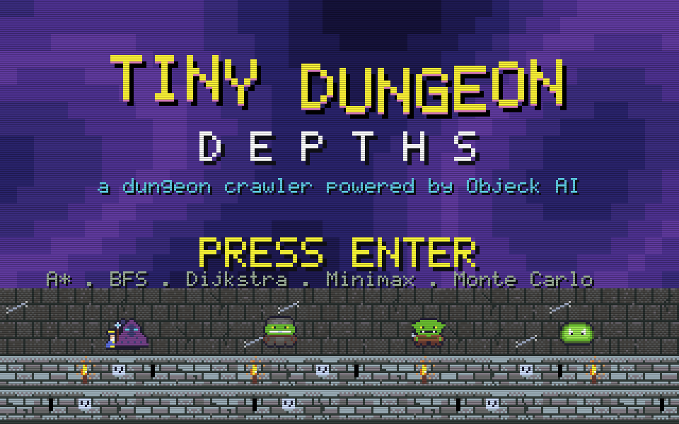
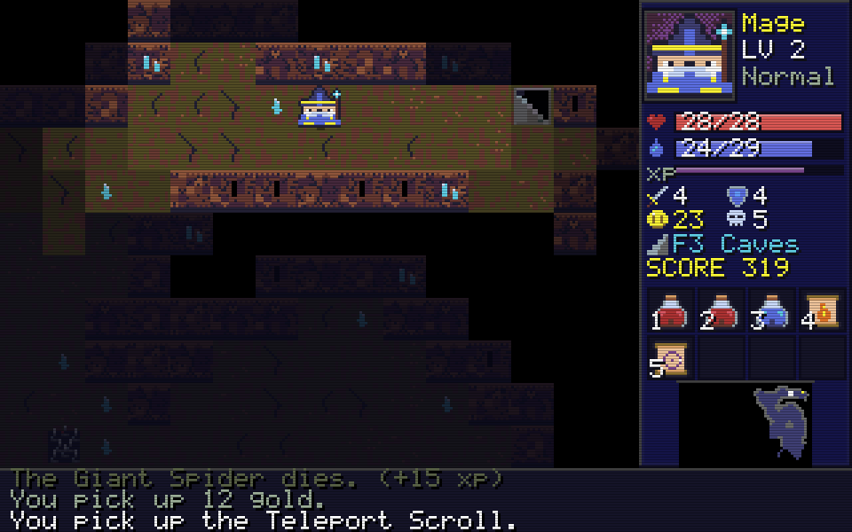
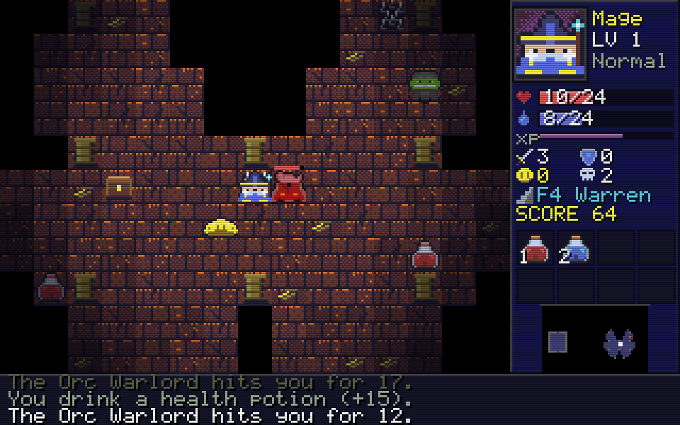
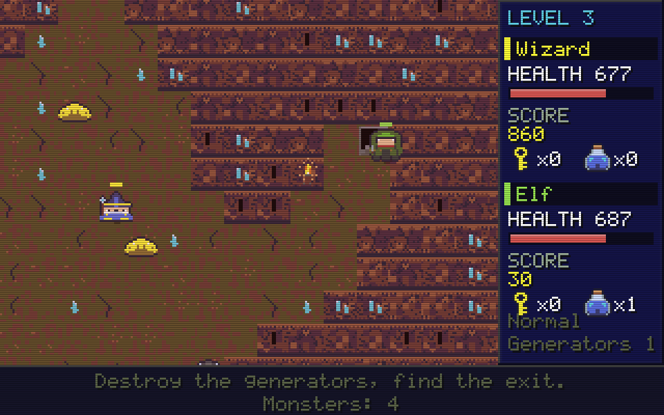

# Tiny Dungeon: Depths and Objeck Gauntlet, two 90s dungeon crawlers whose monsters think with System.AI

This folder holds two games that share one set of pixel art, one font, one sound engine, one level maker and the monsters' search code: **Tiny Dungeon: Depths**, a turn-based roguelike (most of this page), and **Objeck Gauntlet**, a real-time arcade game for one or two players ([jump to it](#objeck-gauntlet)).

 
 

A complete dungeon crawler in a few thousand lines of Objeck: three heroes, eight procedurally
generated floors in eight themes, fourteen monsters, two bosses, items, equipment, chests,
shrines, traps, four difficulty levels, a score, a win and a lose. It is drawn like a
**1990s VGA game** (a 320 x 200 picture, 32 colours, shown three times as large with
a CRT scanline layer) and **every picture and sound is made by code**: no image files, no sound
files, nothing to license.

The point of the example is the monsters. Their minds are the classic AI algorithms in
the `System.AI` library, the same library behind the [checkers](https://github.com/objeck/objeck-lang/tree/master/programs/examples/checkers) example in the Objeck repository:

| Monster | How it thinks | `System.AI` class |
|---|---|---|
| Giant Rat | the fewest steps to you | `BreadthFirst` |
| Skeleton, Goblin, Giant Spider, Yeti | a route over the map around you | `AStar` |
| Orc | A\* to a free square *beside* you, so a pack surrounds you instead of queueing in a corridor | `AStar` |
| Ghost | a route that may cross walls (a wall costs 3, a floor 1) | `Dijkstra` |
| Skeleton Archer, Dark Mage, Fire Imp | a small search of a duel: shoot, close in, back off, blink; it **kites** you | `Minimax` |
| Orc Warlord (floor 4) | the duel again with a charge and a roar that summons goblins | `Minimax` |
| Lich King (floor 8) | bolts, summons, life drain and blinks, picked by simulated fights | `MonteCarloTreeSearch` |
| Cave Bat, Green Slime | no planning on purpose: flutter at random, or crawl straight at you (a slime that survives a hit splits in two) | |

The difficulty buys better thinking, not just bigger numbers: the minimax look-ahead is 2, 4,
6 or 7 plies, the Lich runs 60 to 1000 playouts, monsters that lose sight of you give up
at once on Easy and keep coming on Hard and Nightmare, and Nightmare fills the floors
with more of them.

## Build and run

You need Objeck 2026.11 or newer. Like the rest of this repository, the scripts expect the Objeck
repository cloned next to this one (`../objeck-lang`, with its `core/release/deploy-x64` or
`core/release/deploy` folder built); edit the first lines of `build.cmd` / `build.sh` if yours lives
elsewhere. Then, in this folder:

```
build.cmd depths brun       (Windows)      ./build.sh depths brun       (Linux, macOS)
build.cmd gauntlet brun                    ./build.sh gauntlet brun
build.cmd test                             ./build.sh test
```

(`brun` runs the game after building it; without it the script only builds.) The same thing by hand:

```
cd depths
obc -src dungeon_data.obs,dungeon_level.obs,dungeon_game.obs,dungeon_ai.obs,dungeon_art.obs,dungeon_sound.obs,dungeon_view.obs,dungeon.obs -lib sdl2,sdl_game,ai,json,collect -dest dungeon.obe
obr dungeon.obe
```

It opens a 960 x 600 window (`--scale 2` to `--scale 6` change that). No sound card? The game
carries on silently.

## Playing

Pick a hero and a difficulty on the title screens, then walk with the **arrow keys, WASD or
the number pad**; walking into a monster attacks it. Walking into a door opens it, into a chest
opens that, into a shrine prays at it. Doors, chests and shrines cost a turn, like everything
else: the game is **turn based**, and the monsters move after you do.

| Key | Does |
|---|---|
| arrows, WASD, numpad | walk, bump to fight |
| Q E Z C (numpad 7 9 1 3) | walk diagonally |
| **Space** | your special move (costs rage, focus or mana) |
| 1 to 8 | use that pack item (drink, read, wield, wear) |
| I | open the pack (up/down, Enter) |
| . or X | wait a turn |
| **Enter** or > | go down the stairs when you stand on them |
| H | help |
| F2, F3, F4 | scanlines on/off, sound on/off, **let the computer play** |
| Esc | back to the title |

### The heroes

| Hero | Hit points | Mana | Strong at | Special (cost) |
|---|---|---|---|---|
| **Warrior** | 40 | 10 | armour and staying power | **Whirlwind** (5): hits every monster next to you |
| **Rogue** | 30 | 12 | 25% critical hits, dodges a fifth of all blows | **Shadow Strike** (5): vanish, appear behind the nearest monster in sight, and hit it for triple damage |
| **Mage** | 24 | 24 | mana that comes back quickly | **Fireball** (6): a ball of fire on the nearest monster in sight, burning the squares around it |

Killing things earns experience; a new level adds hit points, mana and attack and heals you
by half. Attack comes from your class, your weapon (+1, +3, +5, +7, +9, +11 by tier), potions
of strength and your level. Defence from your class, your armour and your level takes a
little off every blow.

### The dungeon

| Floor | Place | What lives there |
|---|---|---|
| 1 | The Crypt | rats, bats, slimes, skeletons, goblins |
| 2 | The Sewers | water pools; rats, slimes, spiders, goblins |
| 3 | The Caves | a cavern carved by cellular automata; bats, spiders, archers |
| **4** | **The Goblin Warren** | goblins, orcs, archers and the **Orc Warlord** in his hall |
| 5 | The Frozen Halls | yetis, skeletons, ghosts |
| 6 | The Fire Hold | lava pools; fire imps, orcs, dark mages |
| 7 | The Haunted Library | ghosts, dark mages, spiders |
| **8** | **The Lich Tower** | the **Lich King**, and his court |

Every floor is made from a seed, so a run is reproducible (`--seed 7`) and the floors are
different every game. Rooms are joined by corridors with doors; torches on the walls light
their surroundings; water and lava block the way (but not a bat or a ghost); spikes hurt;
chests hold loot; a shrine heals you once. You see a radius of 7 squares and remember what
you have seen; a Map scroll shows the whole floor.

Things you find: gold and gems (score), potions (health, mana, strength), scrolls (teleport,
map, fire), weapons and armour in six tiers from Rusty Dagger to Dragon Slayer and from Rags to
Mithril Mail. The pack holds eight things. **Score** is gold, gems, 4 points per experience
point of every kill, a bonus for each floor and each level, and 5000 for the crown. Your best
score is kept in `.tiny_dungeon` in your home folder.

## How it is built

The files, in the order you would read them:

| File | Does |
|---|---|
| `dungeon_data.obs` | the tables: tiles, monsters (`DgData->MonStat`), items, classes; the seeded random generator |
| `dungeon_level.obs` | one floor: room-and-corridor and cellular-automata generation, boss arenas, doors, torches, pools, line of sight, field of view |
| `dungeon_game.obs` | the rules: the hero, monsters, items, combat, the pack, turns, and the Graph the route finders search |
| `dungeon_ai.obs` | the monsters' minds (the table above), the duel (`DgDuel`, a `System.AI.GameState`) and the bot that plays |
| `dungeon_art.obs` | all pixel art from code: the DawnBringer 32 palette, tiles for eight themes, heroes, monsters, items, effects, the 5 x 7 bitmap font |
| `dungeon_sound.obs` | the effects and the chiptune, synthesized and mixed in software |
| `dungeon_view.obs` | drawing a frame: lighting, effects, panels and screens |
| `dungeon.obs` | the window, the keys and the 60 frames a second loop |
| `dungeon_tests.obs` | a headless test (below) |

The engine has no window and no sound (`dungeon_data`, `_level`, `_game`, `_ai`), so the same
rules run in the game, in the bot and in the tests. A `DgGame` records what happened as a list
of events (a hit, a pickup, a fireball) that the view turns into particles, floating numbers
and sounds; that is the only thing between the rules and the pictures.

**Path finding.** Each turn `DgGame->PathNext` builds a `Graph` of the 23 x 23 squares
around the hero once (the library's searches scan their nodes, so a small window keeps a
turn cheap) and every monster in range asks it for a route: `BreadthFirst` for rats, `AStar`
(with a Manhattan-distance heuristic) for most of the others, `Dijkstra` over a second graph
in which a wall costs 3 for the ghost.

**The duel.** An archer, a mage, an imp and both bosses do not look at the map: they look at a
`DgDuel`, an abstract picture of one fight (the distance, both sides' hit points, cooldowns,
helpers) that implements `System.AI.GameState`. `Minimax` plays both sides on it; the monster
then does the first move of the best line for real. A search that sees the archer is faster at
range chooses to shoot, retreat, shoot, so archers kite; a Warlord with a charge ready and the
hero two squares away charges. The Lich's `MonteCarloTreeSearch` plays random fights to the
end and picks the move that won most.

## Tests and the demo

```
obc -src dungeon_data.obs,dungeon_level.obs,dungeon_game.obs,dungeon_ai.obs,dungeon_tests.obs -lib ai,collect -dest dungeon_tests.obe
obr dungeon_tests.obe
```

checks, in a couple of seconds with no window: that the exit of every floor of many seeds is
reachable from the entrance, that the rules do what is said (walls, doors, potions, equipment,
stairs, death), that `BreadthFirst`, `AStar` and `Dijkstra` find routes from the same squares
through the game's own graph, that the duel's search shoots when it should and returns legal moves
and that the bot can play whole games on every hero and difficulty without breaking an
invariant (hit points in range, nobody inside a wall or on another creature). `build.cmd test` (or `./build.sh test`)
builds and runs both headless tests in one go.

For pictures instead of play: `obr dungeon.obe --screenshot out.png --scene arena --depth 4
--class 2 --seed 3` saves one frame (scenes: `title`, `select`, `play`, `arena`, `inventory`,
`help`, `dead`, `won`); `obr dungeon.obe --demo frames_dir` lets the computer play and saves
frames, and prints the time a frame takes.

## Objeck Gauntlet

A real-time, one- or two-player arcade crawler in the spirit of the 1985 coin-op: shoot in eight
directions, smash the **monster generators** that keep spawning ghosts, grunts, demons and
sorcerers, pick up keys (they open locked doors), food (your **life force drains all the time**),
treasure and magic potions (a smart bomb), and walk onto the exit. Eight levels from the same
eight themes; **Death** hunts you from level 3 on and only a potion kills him; the last exit is the
Lich King's throne.

```
cd depths
obc -src dungeon_data.obs,dungeon_level.obs,dungeon_game.obs,dungeon_ai.obs,dungeon_art.obs,dungeon_sound.obs,dungeon_view.obs,gauntlet_game.obs,gauntlet.obs -lib sdl2,sdl_game,ai,json,collect -dest gauntlet.obe
obr gauntlet.obe
```

| Player 1 | Player 2 |
|---|---|
| **W A S D** walk | **arrow keys** walk |
| **Space** shoots | **Enter** shoots |
| **E** drinks a magic potion | **Right Shift** drinks a potion |

P pauses, Esc backs out, F2 and F3 turn the scanlines and the sound off, F4 lets the computer play
(a bot, for the demo). In the menus: left/right picks a hero, up/down the difficulty, 1 or 2 the
number of players, Tab switches between picking for player 1 and player 2, Enter starts.
The two heroes share one screen, so neither can wander out of the other's reach.

| Hero | Health | Speed | Strength |
|---|---|---|---|
| Warrior | 900 | slow | strong axes, a tough hide, and a blow for what he touches |
| Valkyrie | 900 | average | the best armour (35% less damage), and a blow for what she touches |
| Wizard | 700 | average | magic: **her potions are twice as strong** |
| Elf | 700 | **fast** | the quickest bow and the fastest shots |

| Monster | Comes from | How it thinks |
|---|---|---|
| Ghost | ghost generator | drifts straight at you, **through walls** |
| Grunt | grunt generator | an `AStar` route over the map around you, so it finds its way round walls and doors |
| Demon | demon generator | a `Minimax` search of a small duel (the same `DgDuel` as the archers of Depths): closes in, backs off, **throws fireballs** |
| Sorcerer | sorcerer generator | the same search with a **blink**: it vanishes and reappears near you |
| Death | his own generator, level 3+ | an `AStar` hunter that cannot be shot; it drains 40 health a touch; a potion kills it |

A generator has a few hit points (shots, and a potion, hurt it) and spawns only when a hero is near.
The difficulty sets how fast monsters move and spawn, how hard they hit, how quickly your
life force drains and how many plies the demons and sorcerers look ahead.
Every locked door on a level has a key to match, and every key is reachable without passing a
locked door (the generator checks this; the test checks it for many seeds).

The engine is `gauntlet_game.obs` (no window; it steps 60 times a second) and the window is
`gauntlet.obs`. `gauntlet_tests.obs` tests the levels, the rules, the monsters and sixteen
random games, headless:

```
obc -src dungeon_data.obs,dungeon_level.obs,dungeon_game.obs,dungeon_ai.obs,gauntlet_game.obs,gauntlet_tests.obs -lib ai,collect -dest gauntlet_tests.obe
obr gauntlet_tests.obe
```

For pictures: `obr gauntlet.obe --screenshot out.png --scene play --level 4
--players 2 --class 2 --frames 500` (the bot plays 500 frames first; scenes `title`, `select`, `play`,
`dead`, `won`), and `--demo frames_dir` lets the computer play, saving frames. `--keys +d,+space,...`
presses keys on a script for tests (`+k` holds a key, `-k` lets go).

## A note for people writing Objeck

Writing these games turned up a compiler bug that is worth knowing about (the toolchain this was
built with is 2026.11.x; it happens in the interpreter and under the JIT alike). Inside a loop that
is itself nested in another loop, a **new local whose initializer does not use the inner loop's own
variable** and that is not changed afterwards reads back 0:

```
each(ty : 3) {
  each(tx : 3) {
    z := a + ty;         # does not mention tx, and z is never changed
    w := z + 100;        # w is 100, not a + ty + 100
  };
};
```

Declare such a value in the outer loop's body, or use a loop variable of the inner loop in it.
The sources here follow that rule (they say so where it matters).
